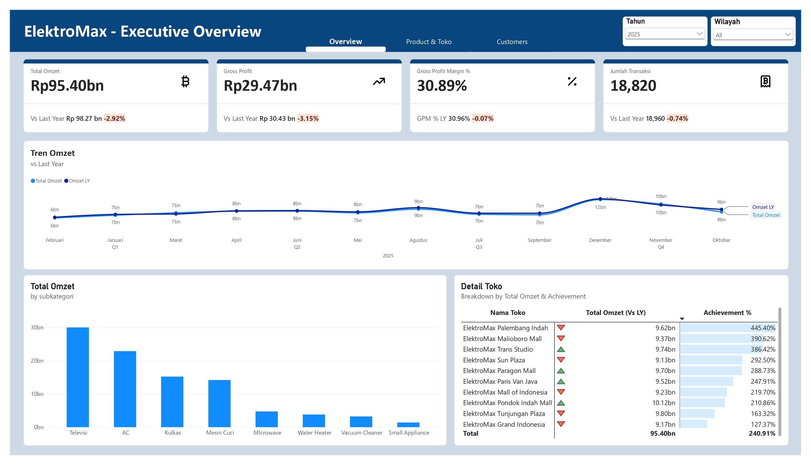
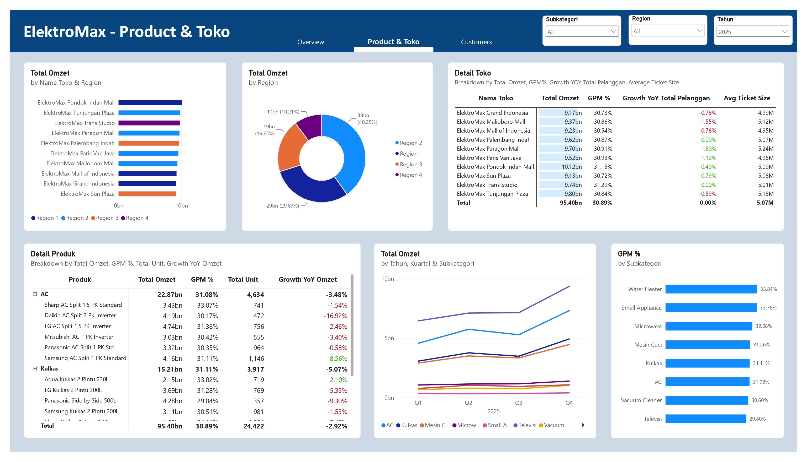
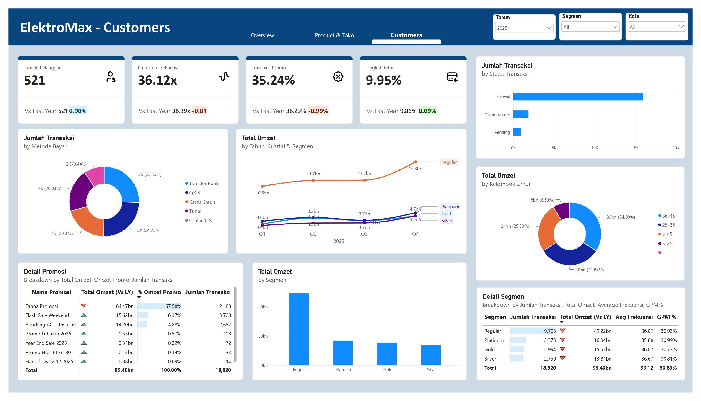

# 📊 ElectroMax — Retail Sales & Customer Analytics Dashboard

## 📌 Project Overview

Project ini merupakan analisis data penjualan **ElectroMax**, sebuah toko retail elektronik, menggunakan **Microsoft Power BI**.

Tujuan project ini adalah menganalisis performa penjualan, profitabilitas, produk, toko, pelanggan, transaksi, serta promosi untuk memperoleh insight yang dapat membantu memahami kondisi bisnis dan mendukung pengambilan keputusan berbasis data.

Dashboard terdiri dari tiga halaman utama:

- **Overview**
- **Product & Toko**
- **Customers**

---

## 🎯 Business Questions

Beberapa pertanyaan bisnis yang ingin dijawab melalui analisis ini:

1. Bagaimana performa omzet dan gross profit ElectroMax?
2. Bagaimana perkembangan omzet dibandingkan tahun sebelumnya?
3. Toko mana yang memiliki performa omzet terbaik?
4. Produk dan subkategori apa yang memberikan kontribusi terbesar?
5. Bagaimana performa setiap region dan toko?
6. Bagaimana karakteristik dan perilaku pelanggan?
7. Seberapa besar kontribusi transaksi yang menggunakan promosi?
8. Metode pembayaran apa yang paling banyak digunakan?
9. Bagaimana performa masing-masing segmen pelanggan?
10. Bagaimana tingkat retur transaksi?

---

## 🛠️ Tools & Technologies

- **Microsoft Power BI**
- **Power Query** — Data Cleaning & Transformation
- **DAX** — Data Modeling & Measures
- **Microsoft Excel** — Data Source

---

## 📂 Dataset Structure

Dataset terdiri dari beberapa tabel yang digunakan untuk membangun analisis:

| Table            | Description                         |
| ---------------- | ----------------------------------- |
| `FACT_PENJUALAN` | Data transaksi penjualan            |
| `DIM_PRODUK`     | Informasi produk                    |
| `DIM_WAKTU`      | Informasi tanggal dan periode waktu |
| `DIM_PELANGGAN`  | Informasi pelanggan                 |
| `DIM_TOKO`       | Informasi toko/cabang               |
| `DIM_KARYAWAN`   | Informasi karyawan                  |
| `DIM_PROMOSI`    | Informasi promosi                   |

Dataset memiliki data transaksi penjualan beserta informasi produk, toko, pelanggan, waktu, promosi, metode pembayaran, serta status transaksi.

---

## 🧹 Data Preparation

Sebelum melakukan analisis, data dipersiapkan menggunakan Power Query.

Tahapan data preparation meliputi:

- Memeriksa struktur dan tipe data
- Membersihkan data yang tidak sesuai
- Menyesuaikan data type setiap kolom
- Menyiapkan tabel fakta dan dimensi
- Memastikan kolom numerik dapat digunakan dalam perhitungan
- Menyiapkan data untuk kebutuhan data modeling dan visualization

---

## 📐 Key Performance Indicators

Dashboard menggunakan beberapa KPI utama:

### Sales Performance

- Total Omzet
- Gross Profit
- Gross Profit Margin (GPM)
- Jumlah Transaksi
- Total Unit

### Customer Performance

- Jumlah Pelanggan
- Rata-rata Frekuensi Transaksi
- Average Ticket Size
- Transaksi Promo
- Tingkat Retur

### Growth Analysis

- Year-over-Year (YoY) Growth
- Perbandingan dengan Last Year (LY)
- Achievement terhadap target

---

# 📊 Dashboard

## 1. Overview

Halaman Overview memberikan gambaran umum mengenai performa bisnis ElectroMax pada tahun 2025.

### Key Metrics

| KPI                 |        Result |
| ------------------- | ------------: |
| Total Omzet         | **Rp95,40 M** |
| Gross Profit        | **Rp29,47 M** |
| Gross Profit Margin |    **30,89%** |
| Jumlah Transaksi    |    **18.820** |

Dibandingkan tahun sebelumnya:

- Omzet turun **2,92%**
- Gross Profit turun **3,15%**
- Gross Profit Margin turun **0,07 percentage point**
- Jumlah transaksi turun **0,74%**

Dashboard juga menampilkan tren omzet bulanan dibandingkan tahun sebelumnya serta performa omzet berdasarkan subkategori dan toko.



## 2. Product & Toko

Halaman ini digunakan untuk menganalisis performa produk dan toko.

Analisis mencakup:

- Total omzet berdasarkan toko
- Total omzet berdasarkan region
- Gross Profit Margin setiap toko
- Growth YoY
- Total pelanggan
- Average Ticket Size
- Total unit produk
- Revenue berdasarkan subkategori
- Growth omzet setiap produk

### Store Performance

Berdasarkan dashboard, **ElektroMax Pondok Indah Mall** memiliki total omzet sebesar **Rp10,12 M**, menjadi salah satu toko dengan omzet tertinggi pada periode analisis.

Sementara itu, **ElektroMax Palembang Indah** memiliki achievement sebesar **445,40%** berdasarkan indikator achievement yang digunakan pada dashboard.



## 3. Customers

Halaman Customers berfokus pada perilaku pelanggan dan transaksi.

### Key Metrics

| Metric              |     Result |
| ------------------- | ---------: |
| Jumlah Pelanggan    |    **521** |
| Rata-rata Frekuensi | **36,12x** |
| Transaksi Promo     | **35,24%** |
| Tingkat Retur       |  **9,95%** |
| Jumlah Transaksi    | **18.820** |

Analisis pelanggan mencakup:

- Metode pembayaran
- Segmen pelanggan
- Kelompok umur
- Promosi
- Total omzet berdasarkan segmen
- Frekuensi transaksi
- Gross Profit Margin



# 💡 Key Insights

Berdasarkan dashboard yang dibuat, beberapa insight utama yang diperoleh adalah:

### 1. Omzet mengalami penurunan YoY

Total omzet tahun 2025 mencapai **Rp95,40 M**, turun **2,92%** dibandingkan tahun sebelumnya yang mencapai **Rp98,27 M**.

Gross profit juga mengalami penurunan sebesar **3,15%**.

Hal ini menunjukkan adanya penurunan performa penjualan dibandingkan periode sebelumnya.

### 2. Profit margin relatif stabil

Gross Profit Margin berada pada **30,89%**, hanya mengalami perubahan sebesar **-0,07 percentage point** dibandingkan tahun sebelumnya.

Artinya, meskipun omzet menurun, tingkat margin secara keseluruhan relatif stabil.

### 3. AC menjadi subkategori dengan omzet terbesar

Subkategori **AC** menghasilkan omzet sebesar **Rp22,87 M** dengan GPM **31,08%**, menjadikannya salah satu kontributor utama terhadap total omzet.

### 4. Pondok Indah Mall memiliki omzet tertinggi

**ElektroMax Pondok Indah Mall** mencatat omzet sebesar **Rp10,12 M**.

Toko ini juga memiliki GPM sebesar **31,15%** berdasarkan dashboard.

### 5. Sebagian besar omzet berasal dari transaksi tanpa promosi

Transaksi **Tanpa Promosi** menghasilkan omzet sebesar **Rp64,47 M** atau **67,58%** dari total omzet.

Sementara itu, **Flash Sale Weekend** menghasilkan **Rp15,62 M** dan **Bundling AC + Instalasi** menghasilkan **Rp14,20 M**.

### 6. Regular merupakan segmen dengan kontribusi omzet terbesar

Segmen **Regular** menghasilkan omzet sebesar **Rp49,22 M** dengan jumlah transaksi **9.703**.

Segmen ini menjadi kontributor terbesar terhadap total omzet berdasarkan segmentasi pelanggan.

### 7. Tingkat retur perlu diperhatikan

Tingkat retur tercatat sebesar **9,95%**.

Angka ini dapat menjadi indikator yang perlu diperhatikan lebih lanjut untuk memahami penyebab transaksi dikembalikan dan dampaknya terhadap performa penjualan.

---

# 💼 Business Recommendations

Berdasarkan hasil analisis, beberapa rekomendasi yang dapat dipertimbangkan:

### 1. Evaluasi penyebab penurunan omzet

Karena omzet mengalami penurunan **2,92% YoY**, perlu dilakukan analisis lebih lanjut terhadap produk, toko, region, dan periode yang mengalami penurunan terbesar.

### 2. Pertahankan performa kategori utama

Kategori dengan kontribusi omzet tinggi seperti **AC** perlu dipertahankan melalui pengelolaan stok, strategi harga, dan promosi yang sesuai.

### 3. Evaluasi efektivitas promosi

Promosi seperti **Flash Sale Weekend** dan **Bundling AC + Instalasi** memberikan kontribusi omzet yang cukup besar.

Analisis lanjutan dapat dilakukan untuk membandingkan revenue dengan profit setelah mempertimbangkan biaya atau dampak diskon.

### 4. Investigasi tingkat retur

Tingkat retur sebesar **9,95%** perlu dianalisis lebih lanjut berdasarkan produk, toko, pelanggan, dan alasan retur untuk mengetahui area yang paling membutuhkan perbaikan.

### 5. Fokus pada customer segmentation

Segmen pelanggan dapat digunakan untuk membuat strategi penjualan yang lebih spesifik, terutama untuk mempertahankan pelanggan dengan frekuensi transaksi tinggi.

---

# 📁 Dashboard Preview

Dashboard dibuat menggunakan **Microsoft Power BI** dan terdiri dari:

**Page 1 — Overview**

- Sales KPI
- Revenue Trend
- Revenue by Subcategory
- Store Performance

**Page 2 — Product & Toko**

- Store & Region Analysis
- Product Performance
- Revenue
- GPM
- Unit Sold
- YoY Growth

**Page 3 — Customers**

- Customer KPI
- Payment Method
- Customer Segment
- Age Group
- Promotion Analysis
- Return Rate

---

# 🚀 Project Workflow

```text
Raw Dataset
     ↓
Data Understanding
     ↓
Data Cleaning & Transformation
     ↓
Data Modeling
     ↓
DAX Measures
     ↓
Data Analysis
     ↓
Dashboard Development
     ↓
Business Insights
     ↓
Business Recommendations
```

---

# 📌 Conclusion

Project **ElectroMax — Retail Sales & Customer Analytics Dashboard** menunjukkan bagaimana data transaksi retail dapat diolah menjadi dashboard interaktif untuk memahami performa penjualan, produk, toko, pelanggan, dan promosi.

Project ini juga menjadi bagian dari pengembangan portfolio **Data Analyst**, dengan fokus pada kemampuan:

- Data Cleaning
- Data Transformation
- Data Modeling
- DAX
- Data Visualization
- Exploratory Data Analysis
- Business Analysis
- Dashboard Development
- Insight & Recommendation

**Tools:** Microsoft Power BI, Power Query, DAX, Microsoft Excel

## 📁 Repository Structure

electromax-retail-sales-analysis/
│
├── README.md
│
├── dataset/
│ └── dataset_elektronik_dirty.xlsx
│
├── powerbi/
└── ElectroMax_Retail_Analytics.pbix
└── dashboard/
├── overview.jpg
├── product-toko.jpg
└── customers.jpg
